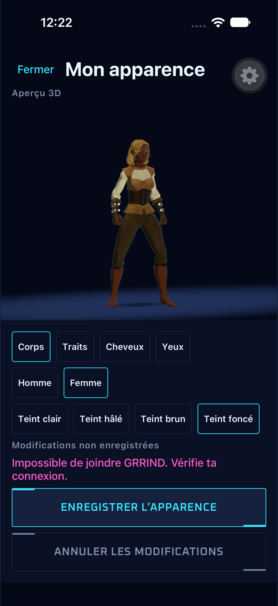
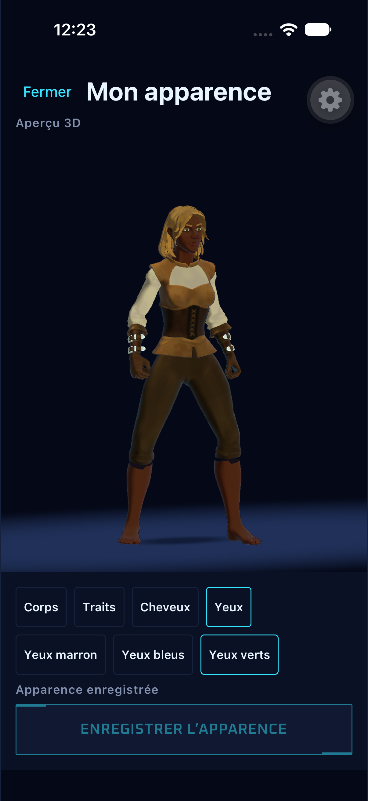
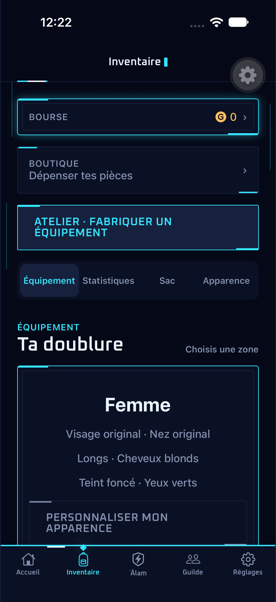
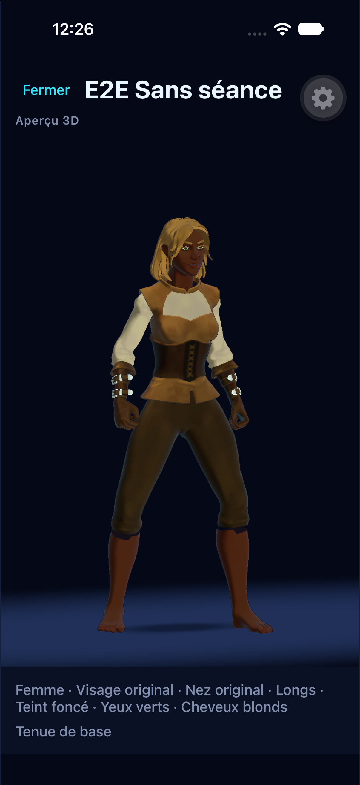

# Apparence persistée — #254

L’entrée **Apparence** de l’inventaire et des réglages ouvre l’aperçu Unity plein écran.
Les options et leurs compatibilités viennent de `/api/avatar-catalog` ; le visage carré
et le nez large restent indépendants et réservés au corps masculin. Le formulaire
enregistre uniquement les huit champs de l’avatar via `PATCH /api/me`. La tenue vient
de l’inventaire serveur ; les combats et replays conservent leurs snapshots (#220).

Validation du 24 octobre 2026 : typecheck, lint, 580 tests et 29 previews passent.
Le parcours `.maestro/avatar-persistence.yaml` passe en 4 min 15 s sur GRRIND E2E,
avec le binaire de développement existant et un seul compte jetable :

- Modifier corps, traits, coiffure, teint et couleurs ; vérifier les compatibilités.
- Provoquer une coupure réseau avant la première sauvegarde, conserver le brouillon,
  puis réessayer sur le vrai backend local.
- Retrouver l’apparence dans l’inventaire et les réglages.
- Se déconnecter, arrêter l’app, relancer et se reconnecter : relire les mêmes choix
  depuis le serveur, sans cache mémoire.

L’aperçu public a aussi été inspecté en lecture seule, sur ce même compte.
Le serveur renvoie bien le corps féminin, les traits d’origine, les cheveux longs
blonds, le teint foncé et les yeux verts après la sauvegarde.

Pour reproduire l’erreur réseau, lancer `node scripts/avatar-qa-proxy.mjs`, puis
`E2E_API_URL=http://localhost:8099 npm run e2e:ios:dev` et
`E2E_API_URL=http://localhost:8099 npm run e2e:ios:flow -- .maestro/avatar-persistence.yaml`.
Le proxy local coupe le premier PATCH d’avatar avant de le transmettre ; il ne
journalise ni les corps des requêtes ni les identifiants de session.
Il faut le redémarrer pour réinjecter cette panne.

| Erreur et brouillon conservé | Après reconnexion et redémarrage |
| --- | --- |
|  |  |

| Inventaire enregistré | Aperçu public en lecture seule |
| --- | --- |
|  |  |

Aucun nouveau mesh, changement natif ou build EAS dans #254. La validation concerne
le Simulator ; la version iPhone du framework Unity modifié par #220 reste à
reconstruire et tester avant une livraison sur appareil.
