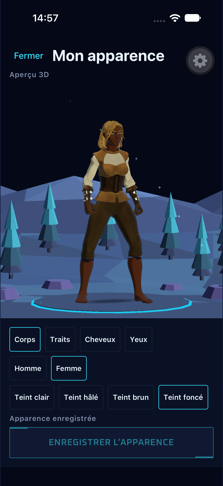
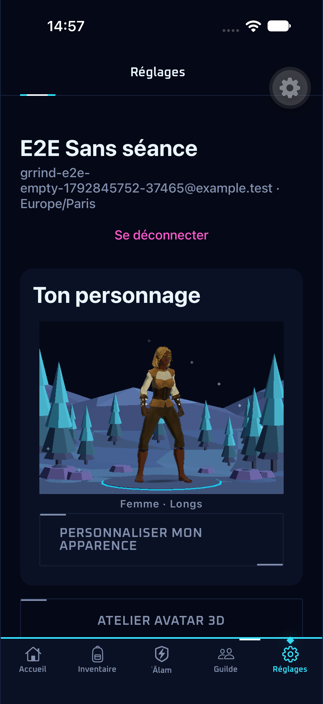
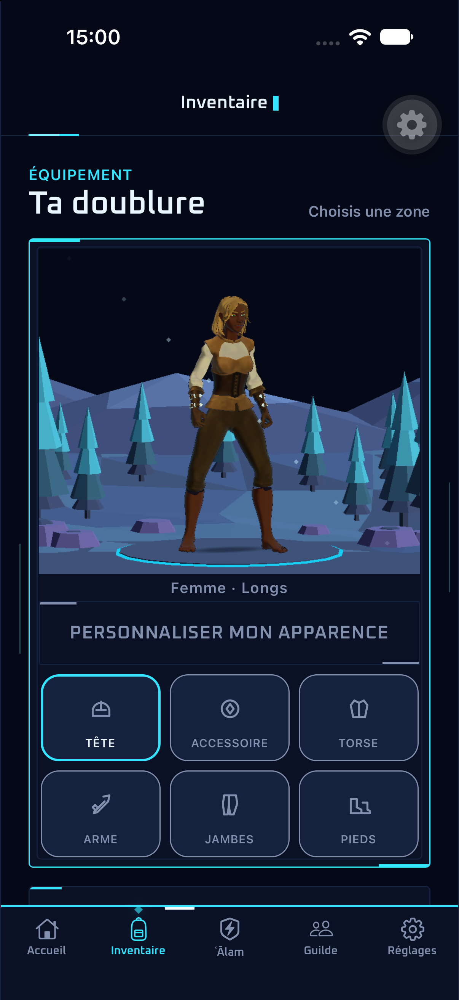

# Avatar visible et décor néon — #263

L’inventaire, les réglages et les profils publics affichent à nouveau le personnage. L’entrée
partagée utilise l’apparence enregistrée et l’équipement de la vue, via `serverAvatar`, comme
la personnalisation. Le résumé reste accessible sur l’image, et le bouton ouvre toujours
l’éditeur plein écran. La sauvegarde conserve son cache de profil par compte.

Unity rend une image hors écran aux dimensions de la carte uniquement lorsque son apparence
ou son équipement change. Sa surface native reste plein écran, derrière React Native, puis
le moteur est mis en pause. Les requêtes sont sérialisées ; une réponse devenue obsolète ne
remplace jamais l’avatar courant. Ouvrir une scène Unity interrompt la capture en cours.
Au retour d’une transition iOS, le bridge peut encore être occupé : seule cette erreur est
réessayée, toutes les 100 ms pendant au plus une seconde. Les tests couvrent le message
enveloppé par Expo, l’abandon d’une ancienne demande et la propagation des erreurs de rendu.
Un échec affiche un bouton de nouvelle tentative et ne substitue pas un ancien personnage.

La clairière utilise les neuf meshes originaux de l’arène d’hiver, avec une palette
indépendante cyan/violet et un socle lumineux. Le combat conserve son décor. Les huit flocons
en losange utilisent l’horloge partagée de l’app ; Réduire les animations les supprime et
l’arrière-plan arrête l’horloge. Pas de textures, d’achat, de génération payante ni de
dépendance supplémentaire.

Packs gratuits consultés : [Kenney Nature Kit, CC0](https://kenney.nl/assets/nature-kit) et
[Low-Poly Simple Nature Pack, Asset Store](https://assetstore.unity.com/packages/3d/environments/landscapes/low-poly-simple-nature-pack-162153).
Ils ne sont pas importés : les formes déjà présentes suffisent et gardent la direction à
facettes. La provenance vit dans `Assets/Spike/AvatarScene/PROVENANCE.json`.

Le rendu suit les API [Camera.targetTexture](https://docs.unity3d.com/6000.3/Documentation/ScriptReference/Camera-targetTexture.html)
et [Texture2D.ReadPixels](https://docs.unity3d.com/6000.3/Documentation/ScriptReference/Texture2D.ReadPixels.html)
de Unity 6.3. Un readback ponctuel produit le PNG en mémoire ; aucune boucle de captures ni
collection de fichiers temporaires sur l’appareil.

## Validation du 24 octobre 2026

Typecheck, lint, 583 tests unitaires et les 29 previews passent. Le test de transition
reproduit d’abord l’erreur native enveloppée par Expo, puis passe après correction.
`avatar-persistence.yaml` passe en 4 min 23 s (`2026-10-24_145430`) : modification du corps,
des traits, du teint et des couleurs, échec réseau conservant le brouillon, sauvegarde,
nouvel aperçu dans l’inventaire et les réglages, puis arrêt du process et reconnexion.
Les reprises réutilisent le même compte jetable ; seules ses données d’apparence sont
remises à l’état initial via les API normales. Aucune migration ni réinitialisation de base.

Les captures ont été inspectées à 1206 × 2622 px. Dans les réglages, le personnage occupe
508 px sur environ 643 px de hauteur d’aperçu (79 %), tête et pieds compris. Les meshes des
personnages et le cadrage de l’atelier sont inchangés. Le contrôle Unity de douze points du
combat conserve son cadrage à 0,000062 px près et rétablit la projection d’inspection.
Deux captures de la carte, espacées de quelques secondes, diffèrent sur 1 585 pixels
dans sa zone de 1002 × 855 px (0,185 %) : les flocons bougent autour du rendu fixe.

L’export Simulator et le build Debug de l’app passent. Le framework installé porte l’UUID
`57D3A73F-B142-381E-AC67-075AF3D41DB5` ; les SHA-256 de ses 16 fichiers Data correspondent à
l’export. Le framework iPhone et son development build restent à mettre à jour et à vérifier
sur appareil physique avant livraison ; aucun build EAS n’a été lancé.

| Personnalisation | Réglages après sauvegarde |
| --- | --- |
|  |  |

