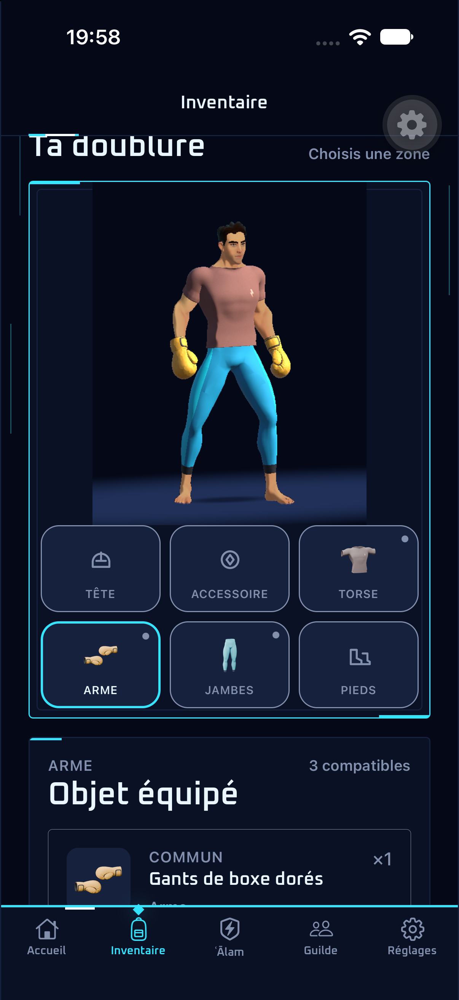
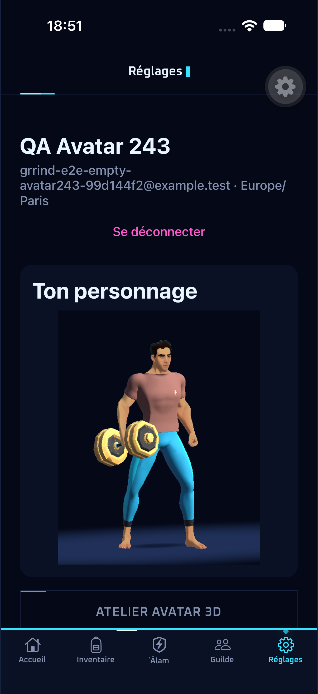

# Aperçu du personnage équipé — #243 / #245

L’inventaire, les profils et les réglages montrent les objets réellement portés, à partir
des six emplacements serveur. Une mutation réussie remplace déjà le cache complet de
l’inventaire : l’aperçu lit cette réponse, sans état d’équipement local.

Les huit objets avec un rendu Unity sont les gants dorés, trois Guinzz, deux t-shirts,
Le Poids Lourd et la variante bleue HALTER_EGO. Les gants occupent `WEAPON` ; équiper
un haltère les remplace et inversement. Retirer l’arme laisse les mains nues et conserve
les vêtements. Les autres emplacements vides reviennent à la tenue Quaternius de base.
Un futur objet sans aperçu conserve son identité et reçoit une indication explicite.

## Captures et contrat

Les 48 combinaisons sont 3 torses × 4 jambes × 4 armes (rien, gants, haltère doré, haltère
bleu). Les captures d’origine de #243 ont été réalisées avec le CLI/Pipeline officiel Unity,
le même modèle, la même pose et la même caméra. #245 retire les 24 combinaisons gants +
haltère, sans modifier les pixels des captures conservées. Elles mesurent 512 × 640 px et
pèsent ensemble 5 247 722 octets. Les 48 SHA-256 sont distincts et vérifiés.

Le personnage et ses objets restent dans `[90, 76, 376, 600]`, soit environ 82 % de la hauteur.
Le manifeste `assets/images/heroes/unity/PROVENANCE.json` garde les sources et la méthode
de mesure. Les noms des PNG conservent ceux des captures d’origine ; les clés du sélecteur
n’ont plus d’axe Mains indépendant.

Code dans `src/features/combat/`, appelants inventaire/profil/réglages ; types du contrat
OpenAPI généré. Les noms traduits ne décident jamais du modèle. Les cases se rangent sur
deux lignes de trois sous l’avatar. Aucun nouveau mesh, build natif ou abonnement ajouté.

Le nettoyage du catalogue et des possessions est terminé en local et en production
([grrind-back#316](https://github.com/younesdiouri/grrind-back/pull/316)), par commande,
sans migration : 17 références sans modèle 3D retirées, HALTER_EGO conservé.
Les snapshots historiques de combat restent distincts de l’inventaire courant et leurs
fixtures sont conservées. Le résolveur et les calques 2D des anciens équipements,
leurs scripts de fabrication et leurs documents de revue ont été supprimés dans #247.
Les sprites rétro servent encore au raid de guilde, sans calques d’équipement.
Les animations de l’haltère en combat et la personnalisation persistante restent
hors du périmètre ; Unity as a Library reste plein écran, les petites vignettes utilisent
ces captures.

## Vérification

`inventory-avatar.yaml` utilise un compte QA déjà provisionné via les API normales, sans
reset de base : équipement à vide, bleu → doré → gants, retrait des gants, t-shirt/pantalon,
puis gants conservés dans les réglages, le profil public en lecture seule et après relancement.
Les paramètres `MAESTRO_AVATAR_EMAIL` et `MAESTRO_AVATAR_PLAYER_ID` restent hors Git.
Les autres flows d’inventaire demandent désormais les objets Unity dans leur préparation.

Gates avant push : typecheck, lint, tests Node, `previews:check` et `api:check`.
Les captures du parcours sont inspectées à la taille iPhone.

Sources : [Unity as a Library](https://docs.unity3d.com/6000.3/Documentation/Manual/UnityasaLibrary.html),
[Expo Image SDK 57](https://docs.expo.dev/versions/v57.0.0/sdk/image/).

## Preuve du 23 octobre 2026 — #245

Types, lint, 571 tests Node et les 29 previews passent. Le flow complet passe en 7 min 29 s
(`artifacts/e2e/2026-10-23_194901`), sans rebuild natif. Les captures à vide, bleu, doré,
gants, retrait, vêtements, réglages, profil public et après relancement ont été inspectées.
Une capture manuelle après ce passage montre l’avatar entier et ses six cases ensemble.
Le même compte QA que #243 a été réutilisé ; aucun nouveau compte créé par le front.

