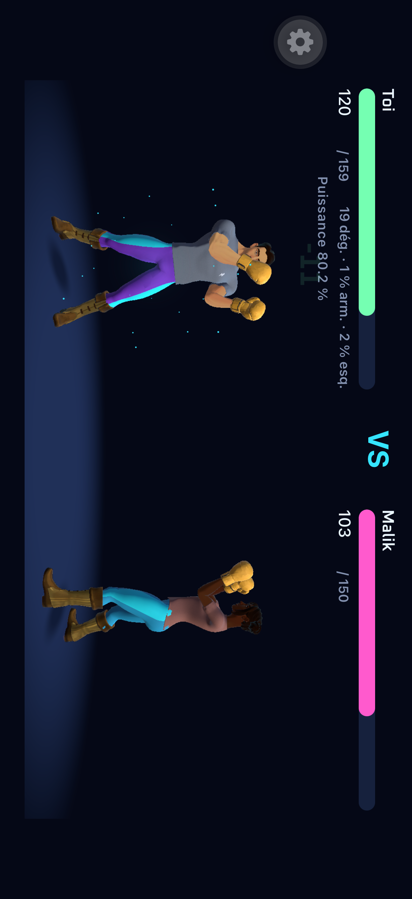
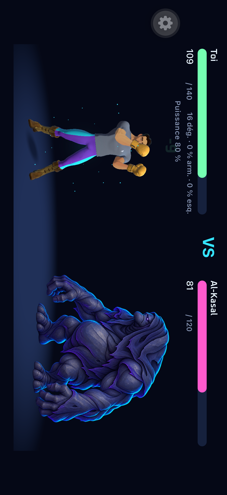
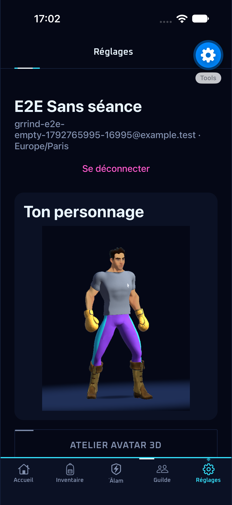
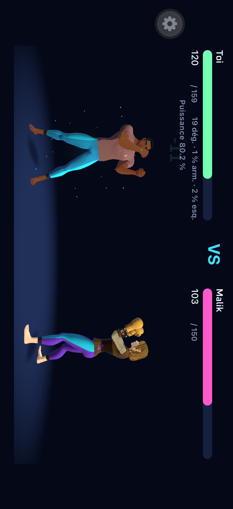
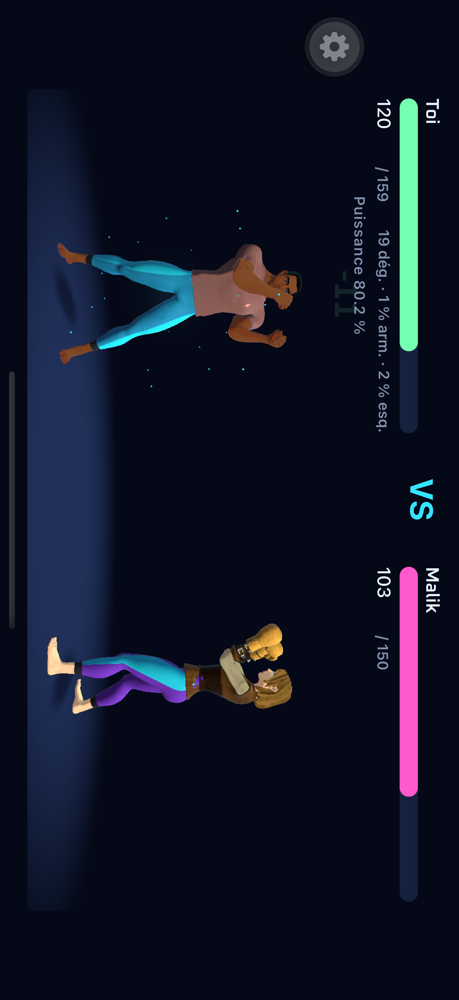

# Personnages Unity du combat 1v1 — #241

## Objectif et périmètre

Utiliser les personnages Quaternius sportifs existants dans les combats solo, les duels PvP
et leurs rejeux. React Native conserve le HUD, Unity présente les personnages et le serveur
reste la source des coups, statistiques et récompenses. Les anciennes apparences serveur
restent lisibles dans les archives, mais leurs sprites ne sont plus chargés en 1v1.

Le héros utilise la tenue sportive existante et l’adversaire PvP sa variante. Les monstres
gardent leurs illustrations. Le raid de guilde est un rendu distinct. Aucune valeur de
personnalisation persistante n’est créée : elle attend le contrat grrind-back#308.

## Mise en œuvre

1. Définir et tester la présentation de l’adversaire : humain Unity ou illustration de mob,
   sans charger le catalogue des anciens héros.
2. Migrer `src/features/combat/BattleView.tsx`, retirer le repli humain 2D et laisser accéder
   au bilan si Unity est absent ou échoue. Garder l’échec et le délai des illustrations de mobs.
3. Supprimer l’ancien atelier et migrer les aperçus du personnage ; retirer l’ancien sélecteur.
   Les petites fiches utilisent une capture du nouveau modèle ; Unity reste plein écran pour
   le combat et l’atelier, conformément aux limites de Unity as a Library sur iOS.
4. Inclure le xcframework local dans l’archive EAS et refuser un build iOS de production sans
   lui. Ne lancer aucun build EAS de production dans ce ticket.

TypeScript strict, composants et tokens existants, aucun ajout de dépendance. Exemple :
`const nativeEnemy = Boolean(battle.enemy.appearance);` utilise le snapshot du combat, pas
le profil actuel. Tests purs à côté du code dans `src/features/combat/*.test.ts`.

## Vérification

Tests ciblés pendant l’édition, puis `npm run typecheck`, `npm run lint`, `npm test` et
`npm run previews:check` une fois sur le code final. Réutiliser le development build et un
flow de présentation via `npm run e2e:ios:dev` puis
`E2E_OFFLINE=1 npm run e2e:ios:flow -- .maestro/appearances.yaml` ; inspecter les captures du duel,
du héros contre un mob, du bilan et du retour. Rebuild natif uniquement après export Unity.
Une session QA déjà connectée ajoute les captures Réglages/inventaire ; terminer ses éventuelles
récompenses en attente avant le parcours. Ce mode conserve la session et ne crée aucun compte.

Vérifier l’archive avec `eas build:inspect --platform ios --stage archive --profile production
--output artifacts/unity-241-eas-archive`. Le prochain candidat de production demandera encore
une vérification iPhone et les mesures de poids, mémoire et chauffe de #218.

## Sources

- [Expo SDK 57](https://docs.expo.dev/versions/v57.0.0/)
- [Inclusion de fichiers locaux avec .easignore](https://docs.expo.dev/build-reference/easignore/)
- [Inspection de l’archive EAS](https://github.com/expo/fyi/blob/main/eas-build-archive.md)
- [Unity 6.3 : intégration iOS et rendu plein écran](https://docs.unity3d.com/6000.3/Documentation/Manual/UnityasaLibrary-iOS.html)

Avant `./scripts/unity-ios.sh`, sauvegarder puis fermer l’éditeur Unity : cette commande lance
un export batch qui ne peut pas partager un projet déjà ouvert. Le CLI officiel peut aussi
appeler `MobileBuild.Device()` et `MobileBuild.Simulator()` dans l’éditeur ouvert ; les étapes
Xcode et d’assemblage du xcframework restent celles du script.

## Preuve du 23 octobre 2026

Typecheck et lint passent ; 563 tests unitaires et les 29 previews passent. Les exports Unity
iPhone et Simulator compilent. L’archive EAS contient les deux binaires et l’aperçu, identiques
aux fichiers locaux ; le podspec accepte le framework présent et rejette son absence en
production. L’export JS iOS de production passe également.

Le flow `appearances.yaml` passe en 1 min 7 s sur le development build installé. La session QA
connectée a effectivement parcouru les aperçus Réglages/Sac, les deux personnages Unity en PvP,
le bilan, le retour, le héros Unity face à Al-Kasal puis l’atelier. Captures inspectées.
Le retour portrait est aussi observé sur une capture stabilisée du même code ; la capture du
dernier flow tombe pendant l’animation de rotation iOS.

Les captures paysage affichées font 2622 × 1206 px (orientation PNG 8). Les zones colorées des
deux personnages PvP mesurent environ 631 et 603 px en hauteur, pieds et têtes dans le cadre.
Le rendu d’aperçu mesure 512 × 640 px ; sa provenance et sa configuration sont à côté de l’asset.

Le candidat iPhone/TestFlight et ses mesures poids/mémoire/chauffe restent à vérifier lors
de la prochaine livraison EAS (#218). Aucun build de production n’a été lancé pour ce ticket.

## Avatars et équipements des snapshots — #220

Les deux acteurs Unity lisent désormais `avatar` et `equipment` depuis le combat reçu, sans
consulter le profil ou l’inventaire courant. Le défaut V1 couvre les anciennes captures locales ;
les réponses serveur normalisent déjà les anciennes archives. Les vêtements sont sélectionnés
indépendamment par slot et les emplacements vides ne reçoivent plus les objets de démonstration.
Les clés sans modèle ne fabriquent aucun équipement de remplacement. Le Poids Lourd et Haltère
ego restent limités à l’inspection par le bridge existant, jusqu’à livraison de clips adaptés.

Typecheck, lint, 569 tests, 29 previews et OpenAPI reproductible passent. Le contrôle Unity
reproduit puis valide l’indépendance haut/pantalon et le retrait des objets sur les deux corps.
Export Unity et build Debug Simulator passent ; UUID et 16 fichiers Data de l’app installée
correspondent à l’export. Le parcours `combat-3d.yaml` passe en 67 s le 24 octobre 2026
(`2026-10-24_115318`). Les captures synthétiques d’apparence sur une timeline HTTP conservée
montrent deux choix distincts et leur rejeu : à 2622 × 1206, les zones cyan/violet des pantalons
gardent leurs dimensions et se décalent de 1 px au maximum. Captures inspectées. Les tests
vérifient aussi que les changements ultérieurs des données courantes ne modifient pas le replay.
La validation iPhone physique reste à effectuer lors d’une prochaine livraison native.

