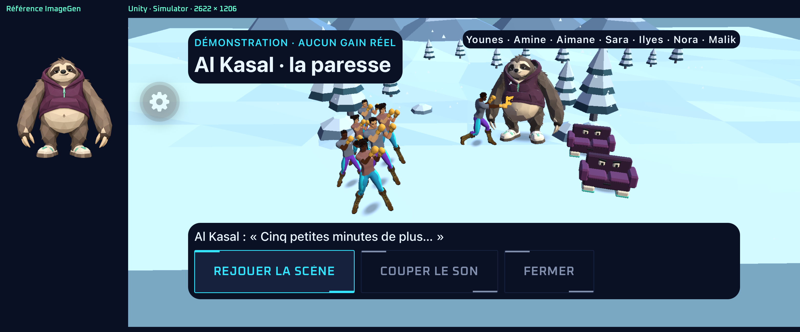
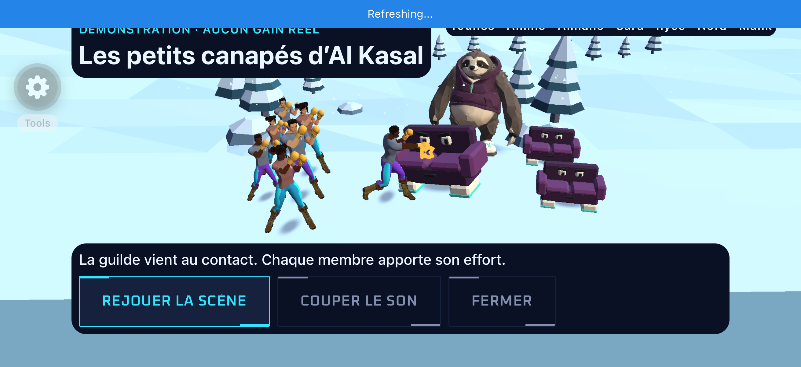
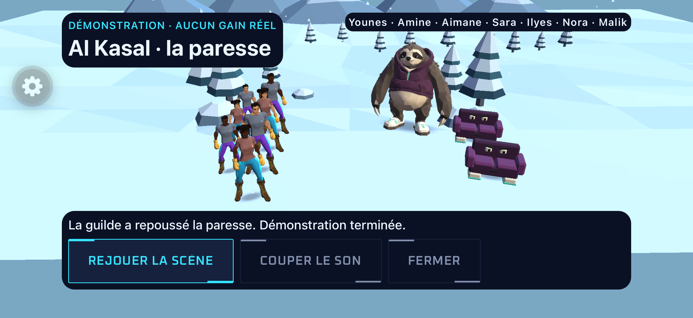

# Al Kasal — raid Unity V1

Ticket #267, demande du 24 octobre 2026. Première tranche de #249 et #251.

Le boss devient un gros paresseux drôle, en sweat prune et chaussons, avec des masses
facettées cohérentes avec Cailloux et les sportifs Quaternius. ImageGen fournit face,
profil et dos ; Meshy 7.1 reconstruit le modèle texturé à environ 6 000 triangles.
Les sources, paramètres, crédits et provenance vivent dans `spikes/art-source/al-kasal-sloth/`.

Le nettoyage #269 retire les sprites 2D, l’ancien atelier Al Kasal 1v1, son flow et les
outils/documents devenus inutiles. Les liens `combat-demo` sans scénario et l’ancienne
défaite Al Kasal ouvrent `/alam-demo`. L’atelier Cailloux et les duels restent accessibles
via `combat-demo?mob=pebble` ; les outils HTTP partagés n’utilisent plus aucun asset Al Kasal.

Vérification #269 : types, lint, 587 tests et 29 previews passent. Le seul parcours mobile
joué est `alam-scene.yaml` : anciennes entrées → raid Unity, frappes, fin et rejeu, vert
en 78 s (`2026-10-24_215243`). Captures inspectées sur le development build déjà installé,
sans rebuild natif. Le serveur de présentation conserve ses dix scénarios, trois PNG
génériques et son échec HTTP 404. Aucun lien vers les anciens fichiers Al Kasal ne subsiste.

Une seule scène Unity paysage présente l’arène d’hiver existante, la neige, Al Kasal
en fond de scène et ses petits canapés animés. Les membres Quaternius se placent ensemble
et viennent frapper au corps à corps avec leurs clips existants. Les petits mobs sont des
serviteurs visuels du boss ; ils ne créent aucune rencontre ni règle supplémentaire.
Le journal serveur reste la source des efforts et des verdicts, sans PV ni dégâts inventés.
Le dernier adversaire d’une édition est le boss ; les précédents sont représentés par les
petits mobs, avec le nom de rencontre serveur conservé dans le HUD.

React Native garde noms, récit, commandes accessibles, résumé et drops serveur. Le rejeu
et la reprise restent des lectures. Si Unity manque ou échoue, les résultats restent accessibles.
Les apparences de participants non servies en 3D utilisent le mannequin V1 de présentation ;
elles ne sont jamais enregistrées comme personnalisation du joueur.

Ordre : référence et modèle contrôlés ; adaptateur du journal testé ; scène Unity et
contacts mesurés ; raccordement réel/atelier et retrait du raid 2D ; un parcours Simulator.

Vérifier l’adaptateur avec les tests Node existants, compiler Unity et contrôler les
positions/cadrages au contact. Exporter seulement la tranche Simulator modifiée et reconstruire
son development build. Puis `E2E_OFFLINE=1 npm run e2e:ios:flow -- .maestro/alam-scene.yaml`,
captures inspectées. Types, lint, tests Node et `previews:check` une fois sur le code final.

TypeScript strict et types API générés : `event.action === 'EFFORT'` choisit une animation,
jamais un calcul métier. Aucun changement de contrat, backend, dépendance ou EAS.
La validation artistique personnelle est attendue sur la V1 dans le Simulator.
La musique d’ambiance est retirée à la demande de l’auteur ; seuls les effets restent.
Les références ont été créées avec l’outil ImageGen intégré. Le
[prompt conservé](../../spikes/art-source/al-kasal-sloth/reference-prompt.txt) et les
[vues](../../spikes/art-source/al-kasal-sloth/ref/) accompagnent le modèle.

Le modèle final conserve 6 070 triangles et une texture 2k. Sa silhouette de face
recouvre la référence à 91,02 % ; l’écart maximal de largeur par bande est de 1,96 %.
La largeur/hauteur est .942 contre .935 dans l’entrée. Pas de lissage ni de décimation.
Le contrôle Blender ne trouve aucun échec ; les sommets dédoublés viennent des normales
et coutures du mesh généré et sont conservés pour préserver les facettes/UV.

Le canapé est un asset original Blender de 748 triangles. Le boss ne possède pas de
rig d’attaque en V1 : ses réactions bougent le corps entier. Les tenues des membres
sont des mannequins de présentation tant que le contrat du raid ne sert pas leur avatar 3D.

Contrôle Unity : 30 états avec 1, 7 et 20 participants, contacts de mêlée, placements sur le
plan de sol, cadrage sûr, neige coupée en mouvements réduits, puis retour raid → inspection
→ duel. Les sommets des sportifs restent entre 36,3 % et 77,1 % de la hauteur utile.

Le parcours `.maestro/alam-scene.yaml` passe en 71 s (session `2026-10-24_203804`),
sans compte ni appel au backend. Captures de la frappe sur canapé, sur le boss,
de la fin naturelle et du rejeu inspectées. Les pieds restent au-dessus du panneau,
le titre se lit sur la neige et aucune musique ne se charge.

Le framework Simulator `88964AAB-38A2-3454-AFDE-F8D96DC47183` est installé ; ses
16 fichiers Data correspondent à l’export. Types, lint, 587 tests Node et 29 previews
passent. Le développement iPhone n’est pas reconstruit dans cette demande : réexporter
sa tranche Unity avant essai sur téléphone ou livraison. Aucun build EAS.

