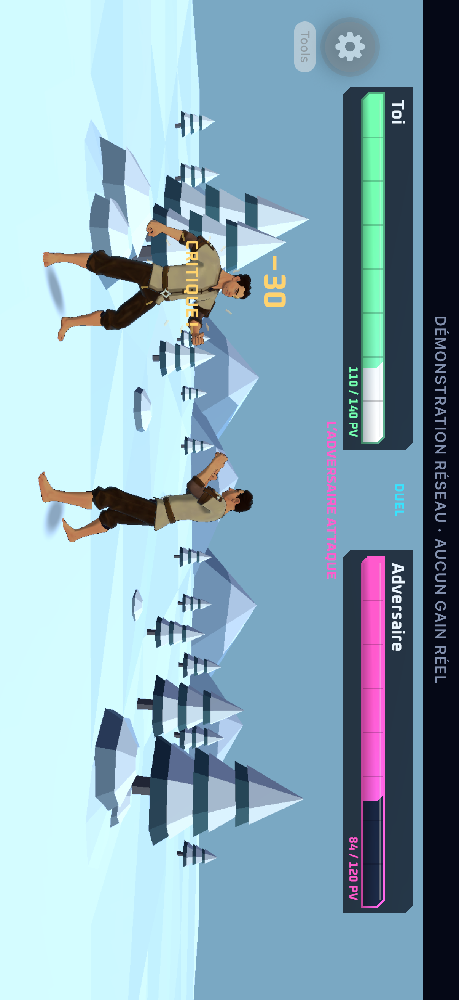
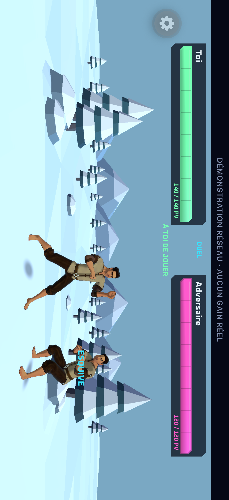
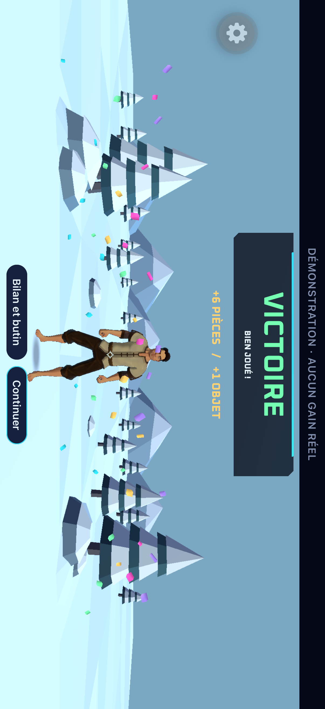
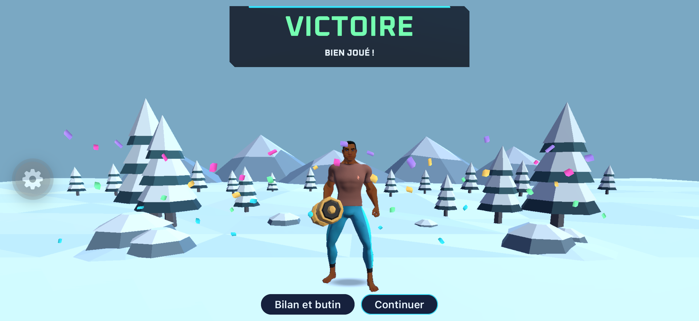
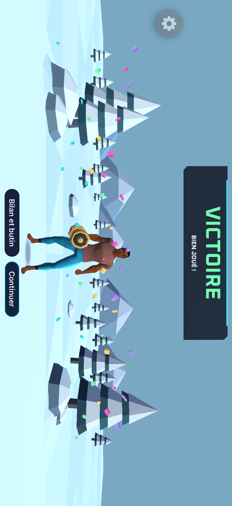

# Combat 1v1 : rythme et présentation Unity — #265

## Objectif validé

Rendre les actions automatiques lisibles comme des tours, attacher les effets aux personnages
et célébrer le résultat dans la scène. Solo existant, PvP et rejeux utilisent les événements,
PV et gains du serveur sans changer leur ordre ni les règles. Aucun push avant la vérification
personnelle de l’auteur sur Simulator. Aucun build EAS.

## Tranches et acceptation

1. **Rythme.** Action ordinaire de 1 300 ms, annonce de combo courte et relance resserrée.
   Préparation, contact vif, réaction, retour en garde puis respiration. Les combats longs
   gardent ce rythme ; ×2 et Passer permettent de les écourter. Les effets disparaissent au
   saut, les PV et résultats restent exacts.
2. **Unity.** Le pont existant transporte les valeurs de présentation de l’horloge unique.
   Unity dessine chiffres, impacts et effets sur les positions projetées des personnages,
   ainsi que le HUD fixe néon facetté. Les textes suivent les personnages mais restent face
   à la caméra. Les illustrations PvE restantes conservent un ancrage dans leur cadre actuel.
3. **Finale.** Le vainqueur est seul au centre, de face, dans la posture neutre existante.
   Le cadre et le titre arrivent avec une animation courte, accompagnés de confettis facettés
   en cas de victoire. Les gains serveur apparaissent ensuite ; les fiches de butin, le bilan détaillé,
   les commandes et l’accessibilité restent en RN. Une fin à la limite ne simule pas de KO.
4. **Preuve.** Compiler/exporter Unity pour le Simulator et l’iPhone, reconstruire le dev build
   concerné, jouer un parcours pertinent et inspecter les captures. Laisser une démo jouable
   à l’auteur avant tout push.

## Fichiers et conventions

Timeline et pont purs dans `src/features/combat/`, tests Node voisins ; rendu uGUI dans
`spikes/Unity3D/Assets/Spike/`. Réutiliser Oxanium et les couleurs néon existantes, sans nouvelle
dépendance. Exemple : `sampleRamp(timeline.enemy.hp, time)` lit la valeur serveur déjà animée.
Le cadre des illustrations et le raid ne sont pas remplacés ici (#249/#251).

## Vérification

Tests ciblés via `node --test --import ./scripts/use-module-hooks.ts src/features/combat/*.test.ts`
(avec les options Node du script npm). À la fin : `npm run typecheck`, `npm run lint`, `npm test`
et `npm run previews:check`. Export Simulator avec le CLI officiel Unity et
`MobileBuild.Simulator`, puis `npm run e2e:ios:dev` et le parcours de présentation approprié,
selon `docs/ai/mobile-qa.md`. Aucun changement du backend ni du contrat API.

Sources : [Expo SDK 57](https://docs.expo.dev/versions/v57.0.0/),
[uGUI 2.0 Canvas](https://docs.unity3d.com/Packages/com.unity.ugui@2.0/manual/class-Canvas.html),
[CanvasScaler](https://docs.unity3d.com/Packages/com.unity.ugui@2.0/manual/script-CanvasScaler.html)
et [projection Unity 6000.3](https://docs.unity3d.com/6000.3/Documentation/ScriptReference/Camera.WorldToScreenPoint.html).
Les mouvements réduits retirent les déplacements, secousses et
particules tout en conservant les valeurs et les annonces lisibles.

## Vérification locale du 24 octobre 2026

- Types, lint, 587 tests Node et 29 previews : verts sur le code final.
- Export Unity Simulator et development build Debug : verts. Le framework installé porte
  l’UUID `263DB847-3935-3474-AB5D-779A64BFC6A9`, identique à l’export.
- `E2E_OFFLINE=1 npm run e2e:ios:flow -- .maestro/combat-3d.yaml` : vert en 3 min 37 s.
  Huit effets/camps, limite sans KO, Passer, lecture naturelle PvP à ×2, victoire et défaite
  PvE, détails et retour portrait ; captures inspectées (`2026-10-24_160657`). Aucun compte créé.
- `E2E_OFFLINE=1 npm run e2e:ios:flow -- .maestro/combat-loot-preview.yaml` : vert en 65 s.
  La capture HTTP annonce 6 pièces et 1 objet ; la finale Unity et le bilan RN montrent ces
  mêmes valeurs, sans crédit réel (`2026-10-24_161445`). L’aperçu reste accessible sans session
  depuis « Aperçu victoire et butin » dans l’atelier.
- Captures paysage de 2622 × 1206 px. L’effet est ancré au corps, le nombre au-dessus de la
  tête. Le premier cadrage est re-mesuré après la rotation ; les captures suivantes confirment
  la même échelle. Aucun message d’erreur du bridge dans le journal iOS du parcours final.

Le premier essai natif a exposé une collision de noms avec UnitySendMessage : les méthodes
du composant de rendu se nomment désormais `Setup`/`DrawFrame`, seuls `BattleBridge.Configure`
et `BattleBridge.Present` reçoivent les messages JSON. Le protocole a été rejoué dans l’éditeur
avec `GameObject.SendMessage` avant le nouvel export, puis vérifié sur Simulator.

VoiceOver et les grands réglages de texte conservent le HUD RN accessible.
Le verdict artistique de l’auteur reste attendu. Aucun push, PR, merge ou EAS.

### Mise à niveau du development build iPhone

Le 24 octobre, l’iPhone conservait l’ancien framework Device : le nouveau JS attendait le HUD,
la finale et la capture d’avatar absents de ce binaire. Export Device, compilation du framework
et build Debug iPhone réussis ; l’installation remplace `app.grrind.dev` en conservant sa session.
Le framework de l’app construite porte l’UUID `890E81DC-275E-31BA-A6A5-5DC43B8E1741` et ses
16 fichiers Data correspondent à l’export. Aperçu enregistré, HUD et victoire observés sur
l’iPhone, dont un duel local joué naturellement jusqu’au verdict, sans Passer.
Captures de 1206 × 2622 et 2622 × 1206 px. Le libellé corps/coiffure sous l’aperçu
est supprimé ; sa description complète reste accessible à VoiceOver.

Types, lint, 587 tests et 29 previews passent. Le parcours `appearances.yaml`, précédé de la
connexion du compte QA, passe en 5 min 2 s (`2026-10-24_180828`) et couvre les aperçus,
les huit effets/camps, le PvP naturel, les finales PvE et le retour portrait. Captures inspectées.
Les exports/intermédiaires Unity de cette compilation sont retirés après copie du framework
courant et installation ; aucun historique de builds n’est ajouté.

### Retour sur le Poids Lourd et la finale

L’auteur demande ensuite d’afficher son arme équipée avec les gestes actuels, en conservant
seulement le direct et l’uppercut critique. La restriction native à l’inspection est retirée.
L’annonce de combo garde le repos neutre et la relance utilise le direct ; les réactions
restent disponibles. Les limites des clips et le contrôle géométrique sont consignés dans
`le-poids-lourd-pilot.md`, sans présenter l’essai comme une validation des collisions.

Le lever de bras procédural est supprimé. Le gagnant Unity rejoint le centre, se tourne vers
la caméra et garde la posture neutre existante. L’autre personnage et les barres de vie
disparaissent. Le titre et les gains occupent le haut du cadre, au-dessus du visage ; des
confettis polygonaux néon accompagnent la victoire et sont retirés en mouvements réduits.
Un adversaire PvE encore illustré conserve son rendu existant.

Les contrôles Unity vérifient l’arme sur les deux corps, le gagnant seul au centre et de face,
la posture neutre, les confettis, les mouvements réduits et le retour des acteurs au rejeu.
Le cadrage final utilise une zone fixe, indépendante de la hauteur du stage RN : le premier
parcours avait révélé des pieds masqués par les boutons en PvE. Le contrôle de projection
passe pour les deux hauteurs de stage, en victoire et en défaite.
Les deux exports et frameworks compilent : Simulator `0903457E-2EEE-30AC-A9BD-EB1D622A9A0E`,
Device `9A60B418-D925-341E-88A8-E1296ECD62FA`. Binaire et 16 fichiers Data de chaque tranche
copiée identiques à la compilation ; exports et intermédiaires Unity supprimés après copie.
Types, lint, 587 tests Node et 29 previews passent.

Le parcours ciblé `combat-loot-preview.yaml` passe en **1 min 49 s**, session
`2026-10-24_193345` : direct et uppercut sur les deux corps, duel naturel jusqu’au gagnant
centré, victoire PvE avec 6 pièces/1 objet, bilan et retour portrait. Captures inspectées.
Le contrôle d’opacité reproduit les confettis trop pâles avant correction du fondu, puis passe ;
les mouvements réduits les suppriment toujours. Une compilation Simulator sans signature avait
exposé une erreur Keychain pendant la vérification ; la signature normale et ses autorisations
sont rétablies, et cette erreur est absente du parcours final.

Le development build iPhone est installé en conservant la session. Le poids est visible sur
les deux combattants ; le duel local a été joué naturellement jusqu’à la nouvelle victoire.
Capture de 2622 × 1206 px, gagnant sur l’axe central X=1311 ; dernier pixel du pied à Y=1096,
bord supérieur des boutons à Y=1105, soit 8 pixels libres. Les exports et caches de compilation
Unity temporaires sont retirés ; les tranches
courantes et les caches Xcode restent. Metro iPhone est conservé, Metro E2E et Simulator arrêtés.
Aucun push, PR, merge ou EAS.

