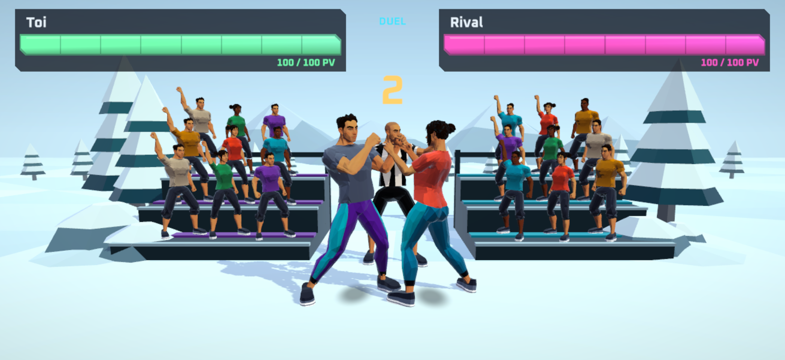
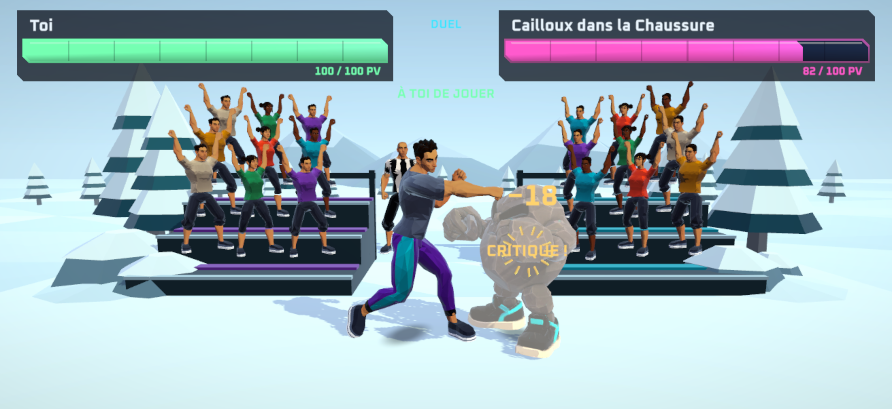

# Arène vivante — #316

La clairière facettée accueille deux tribunes et 18 spectateurs Quaternius en tenues
colorées. Le centre reste dégagé pour les deux combattants. Un arbitre chauve en noir
et blanc donne le départ : 3, 2, 1, FIGHT, puis s’éloigne par l’allée centrale. Le
sifflement dure 300 ms et respecte le mode silencieux du téléphone.

L’ouverture dure 3,4 s ; le sifflet part à 2,4 s. Après le retour auteur du 28 octobre,
le public joue cinq vrais clips Mixamo : applaudissements, encouragement à deux poings,
poing levé, relance des supporters et encouragement énergique. Les corps facettés restent
ceux de Quaternius. Chaque spectateur a sa phase et sa vitesse (0,86 à 1,13), sans alternance
brutale de meshes ni balancement ajouté par code. Les critiques ne pilotent plus le public.

Les 18 spectateurs utilisent les mêmes meshes et matériaux partagés (201 672 triangles),
sans ombres, lumières, colliders, contraintes de combat ni logique de personnage. Leurs
Animators et celui de l’arbitre partagent un seul graphe manuel ; aucun contrôleur ni horloge
libre. Tout suit le temps du rejeu. Réduire les animations fige les encouragements et place
l’arbitre en retrait. Le décor ne s’affiche ni dans Apparence ni dans le raid. Aucune
génération payante. Les sources FBX, paramètres et SHA-256 sont documentés dans
`Assets/Animations/Mixamo/Crowd/PROVENANCE.json` ; les builders et la provenance générale
restent sous `spikes/art-source/living-arena/` et `Assets/Editor/LivingArenaAssets.cs`.

## Preuves

Captures Unity de présentation, avec le vrai HUD et un viewport mobile, demandées à
2622 × 1206 via `capture_game_view` ; ce ne sont pas des captures de l’app sur l’iPhone.
Les points de vie affichés ici appartiennent au scénario de contrôle, pas à un compte.

Ces captures appartiennent à la première itération. Le retour du 28 octobre est prouvé
par les contrôles de mouvement et doit être jugé dans la nouvelle app sur iPhone.

`LivingArenaChecks.Run()` contrôle les gestes Humanoid en boucle, le mouvement de chaque
spectateur et la continuité des mains sur dix secondes, l’absence totale de réaction aux
critiques, le compte à rebours, le retrait de l’arbitre, le rejeu, une horloge figée,
Réduire les animations et l’aller-retour inspection/combat. Les contacts Quaternius restent
contrôlés séparément.

Le contrôle existant de la clairière passe : 924 volumes de personnage, zéro chevauchement
avec le décor. Les douze points de projection restent à moins de 0,000092 px du cadrage
de référence. Le contrôle complet a utilisé le job détaché officiel Unity, car ses 6,7 s
dépassent le délai de cinq secondes de `eval` direct.

La correction #315 rétablit le moveset de Cailloux, les sockets du rig Generic et sa chute
de KO. Cinquante échantillons passent, avec un appui au sol à moins de 0,4 mm de la référence.
Les effets sont désormais calculés après la pose, avec un ancrage corporel proche du poing ;
un contrôle vérifie que les étincelles ne restent pas à l’ancienne position. Le HUD du mob
utilise ses sockets réels. La console finale ne contient aucune erreur ou alerte.

TypeScript, lint, 608 tests et 31 previews déterministes passent. Le framework iPhone a
été exporté et compilé, puis installé sur l’iPhone via `devicectl`. L’UUID embarqué
`3BF58925-CA64-366E-BE50-3F4DC7164A6B` et les SHA-256 des 16 fichiers Data correspondent
à l’export. La mise à jour du public a été installée et lancée avec Metro 8081, puis validée par
l’auteur sur son iPhone le 28 octobre : « franchement mon gars vraiment bien joué c’est
vraiment lourd ». Il autorise le push, la fusion et le déploiement. Le smoke de sortie
passe en 183 s et les 59 fichiers du framework dans l’archive EAS correspondent aux
fichiers locaux. Le suivi du candidat de production reste dans le ticket #316.
