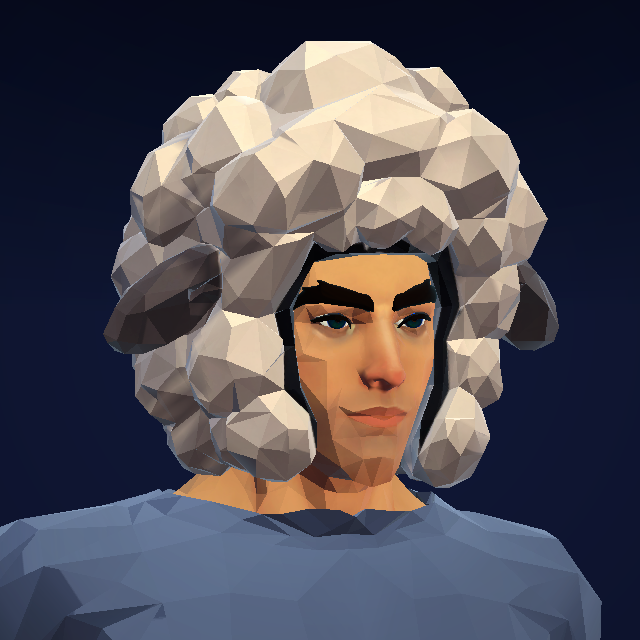
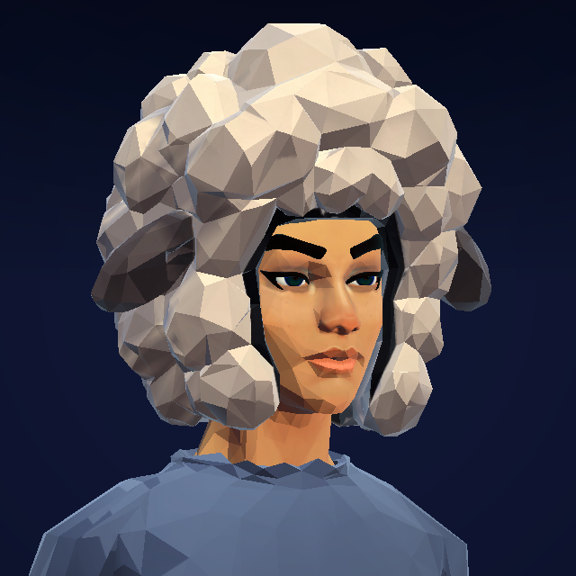

# La Moumoutivation

Premier pilote demandé et concept approuvé le 1er novembre 2026 : « ok j’aime bien,
c’est top go pour l’intégrer ». Une grosse coiffe de laine ivoire facettée, petites
oreilles de mouton, visage dégagé. Ticket #343.

## Modèle et ajustement

Référence approuvée et vues ImageGen de construction dans
`spikes/art-source/moumoutivation/ref/`. Meshy 7.1 multi-image, géométrie 2k,
cible 2 000 triangles et texture 2k : tâche `01a197d3-445d-77be-84fc-3b9fd1b0243e`,
**35 crédits consommés**. Le modèle produit contient **2 094 triangles** ; ses
triangles et UV sont conservés. Blender ajuste les dimensions sur les véritables
têtes Quaternius et utilise un ombrage par face. Aucun nouveau corps ni rig.

| Ajustement | Largeur × profondeur × hauteur |
| --- | --- |
| Homme | 399 × 309 × 351 mm |
| Femme | 388 × 315 × 361 mm |

Le script reproductible est `build/01_fit_and_export.py`, dans le même dossier
que le GLB source, la texture, `tasks.json` et `asset-manifest.json`. Il utilise
le script commun du skill `grrind-character-art` et le profil `headwear-fit.json` ;
son test reproduit exactement les géométries et UV des deux FBX livrés. Le master
Blender reste local conformément au `.gitignore`. Les deux FBX livrés et leur
provenance sont dans `spikes/Unity3D/Assets/Characters/Moumoutivation/`.
Dos, profondeur et doublure sont inférés. La conversion de Meshy vers le repère
de repos Quaternius inclut une rotation de 180° autour de Z : le premier essai
avait placé le dos devant le visage, corrigé avant livraison.

La silhouette extérieure du mesh brut atteint une IoU de **0,936** avec la vue
de construction de face, après alignement des boîtes et remplissage de
l’ouverture intérieure. Rapport largeur/hauteur : **1,160 contre 1,145** ; les
écarts de largeur aux dix bandes vont de −0,082 à +0,031 hauteur normalisée.
Cela documente les variations du mesh ; ce n’est pas une conformité parfaite au
concept. Le rendu Unity est plus contrasté que l’illustration initiale.

## Essayer

Dans **GRRIND dev → Réglages → Atelier avatar 3D → Tester la Moumoutivation** :
la coiffe est présélectionnée, avec Tenue et le cadrage Visage ouverts. Le lien direct
`grrindapp-dev://character-showcase?item=moumoutivation` ouvre le même essai.
Le bouton de retrait restitue la coiffure choisie ; équiper le bandeau retire
la coiffe. Le changement homme/femme conserve la sélection. Le duel de
démonstration reçoit aussi la coiffe. Aucun équipement serveur ni loot ajouté.

`Moumoutivation.Build()` installe les deux ajustements sous l’os Humanoid Head
et participe à `QuaterniusPoc.Build()`. La coiffe masque toutes les coiffures
et tous les bandeaux, puis les choix configurés reviennent au retrait.

## Vérification

Compilation C# et validations `Moumoutivation.Validate()` et
`QuaterniusPoc.Validate()` réussies : attache Head, exclusion et restitution
des coiffures/bandeaux pour les deux corps. Inspection des gros plans Unity
ci-dessous dans la scène Arena. Le validateur Blender n’a aucun échec ; les
sommets dupliqués aux coutures UV/normales Meshy sont conservés. Le réimport
FBX masculin garde 2 094 triangles et une hauteur de 351,3 mm, sans erreur.
Typecheck, lint, tests unitaires et 36 previews passent.

La tranche iPhone est reconstruite seule ; la tranche Simulator existante est
réutilisée. Pas de Maestro pour ce changement visuel, de modification backend
ni de publication EAS/TestFlight. Le verdict artistique final revient à
l’auteur sur son iPhone : volume, ouverture autour du visage, lecture en duel
et passage homme/femme.

L’export Unity, le framework Device et l’app hôte Debug ont compilé sans erreur.
L’app `app.grrind.dev` est installée sur l’iPhone de l’auteur via `devicectl`.
Le framework embarqué conserve l’UUID `AAC6C530-4646-37C3-B9E1-1B86CA598BAE`
du build courant, ses 16 fichiers Data sont identiques et sa metadata contient
`SetMoumoutivation`. Metro 8081 reste disponible pour l’essai.

