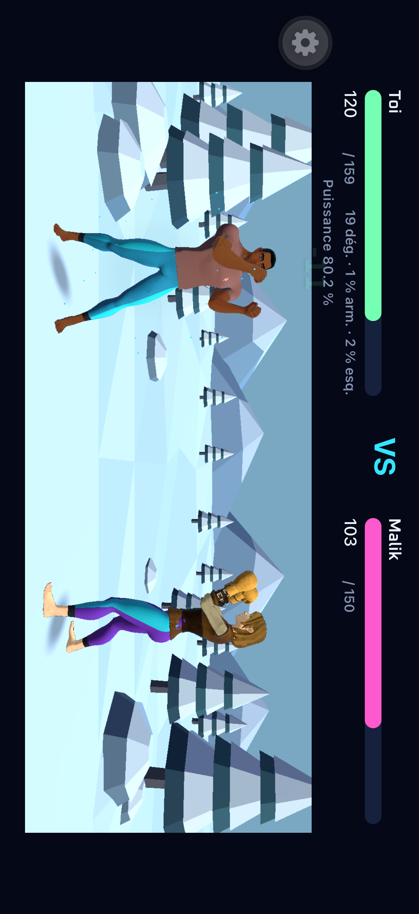
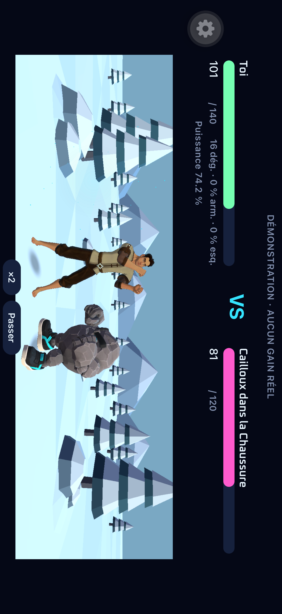
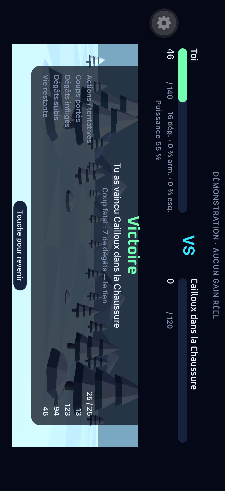
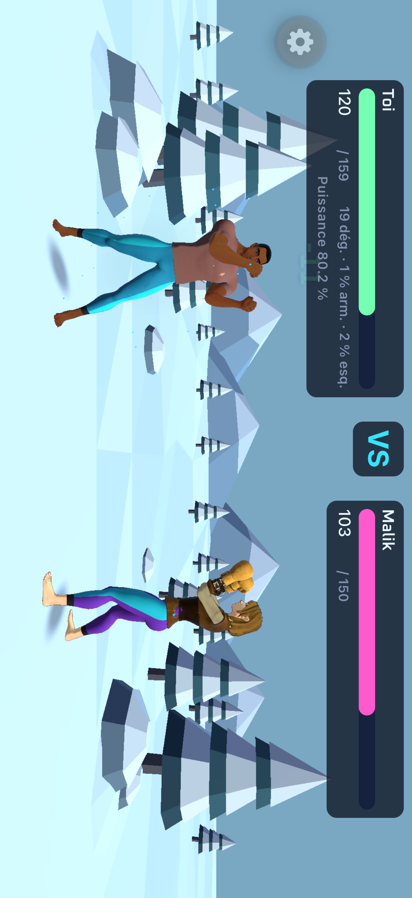
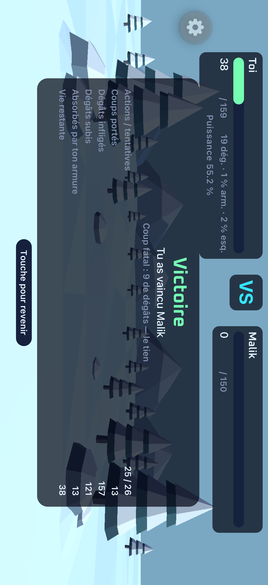

# Clairière d’hiver du combat 1v1

Le combat se déroule sur une clairière enneigée facettée, avec sapins étagés, rochers coiffés de neige et crêtes bleutées en arrière-plan. Le décor couvre tout l’écran, derrière le HUD. Les volumes simples et les aplats accompagnent les personnages Quaternius. Le centre reste calme et dégagé ; les silhouettes et le HUD gardent la priorité.

Le décor statique vit dans `spikes/Unity3D/Assets/Spike/Winter/` et dans `Arena.unity`, composé avec le CLI officiel Unity. Sa source et sa provenance sont dans `spikes/art-source/winter-arena/`. Le bridge active ce décor uniquement en combat. Le sol de déplacement reste à y=0 ; arbres et rochers sont derrière le couloir, les congères latérales hors de sa largeur. Aucun collider ni calcul de déplacement supplémentaire.

Ordre : composer les volumes et vérifier le cadrage Unity, contrôler les poses et déplacements, exporter les frameworks locaux, réutiliser le development build sur le Simulator dédié et jouer `.maestro/combat-3d.yaml`. L’atelier doit conserver son fond et son cadrage.

Vérification : mesures de dégagement et captures via `unity command script eval` et les commandes de capture officielles ; `E2E_OFFLINE=1 npm run e2e:ios:flow -- .maestro/combat-3d.yaml`. Avant push : `npm run typecheck`, `npm run lint`, `npm test`, `npm run previews:check`. Pas de changement de contrat, de dépendance ni de livraison EAS.

La réussite demande un combat complet jusqu’au bilan, les deux côtés et leurs approches sans traversée d’un décor, le plan de déplacement conservé au sol et un retour correct à l’atelier.

## Contrôle Unity du 24 octobre 2026

Le décor utilise 1 732 triangles, neuf meshes/matériaux et zéro texture ou collider. `WinterArenaChecks.ValidateMotion()` échantillonne le bridge et les meshes déformés réels : sept poses, onze phases, deux attaquants et trois ratios paysage (2,1 / 2,54 / 2,9), soit 924 volumes de personnage sans intersection avec une facette surélevée du décor. La profondeur occupée va de -0,516 à +0,627 m ; l’extension latérale atteint 2,598 m. Les placements restent à y=0. L’aller-retour combat → inspection → combat passe aussi.

Le contrôle de contact existant `QuaterniusPoc.ValidateDuel()` passe : écart horizontal main/torse de 8,5 et 11,5 cm, sous son seuil de 30 cm. Le décor ne modifie ni l’approche, ni les animations, ni l’horloge des coups.

Revue : les grands sapins encadrent les côtés ; la forêt basse et les crêtes étagées laissent les têtes et le centre lisibles. Les facettes du sol restent discrètes sur la piste. Les volumes statiques évitent d’ajouter une animation concurrente aux attaques. Ces mesures de géométrie ne constituent pas une mesure de performance sur iPhone physique.

## Vérification dans l’app

Les exports Unity iPhone et Simulator et le build Debug de l’app passent. Le framework installé porte l’UUID `636D6671-FE99-3F1C-8319-5E9A6450FDE6` et ses 16 fichiers Data correspondent par SHA-256 à l’export local.

Le parcours `.maestro/combat-3d.yaml` passe en 1 min 7 s le 24 octobre (`2026-10-24_130818`) : duel et rejeu figés, bilan PvP, attaque et contre-attaque de Cailloux, retour à l’atelier et victoire naturelle de 25 actions jusqu’au bilan, sans passer le combat. Le premier essai s’était arrêté avant le combat sur une récompense en attente de la session QA ; ses pages ont été terminées normalement, sans reset ni création de compte.

À 2622 × 1206 px, les zones cyan/violet des pantalons gardent leurs hauteurs (273 / 274 px). Leur largeur passe respectivement de 245 à 244 px et reste à 112 px ; aucun changement de proportions ou de placement n’est mesuré au-delà d’un pixel face à la [capture antérieure](../ai/unity-1v1/pvp-avatar.png).

La revue du bilan a relevé un lien de retour trop clair sur la neige. Son fond sombre et son texte clair reprennent les tokens des commandes existantes. Le même parcours repasse après cette retouche en 1 min 9 s (`2026-10-24_131141`), sans reconstruction native. Les captures finales ont été inspectées. Le typecheck, le lint, les 580 tests et les 29 previews passent après cette retouche. La scène ne change pas le contrat API.

La validation sur iPhone physique et les mesures de chauffe/mémoire restent à faire lors d’une livraison native. Aucun build EAS de production n’a été lancé.

## Arène plein écran — #261

Le décor doit couvrir toute la surface paysage, derrière les barres de vie et jusqu’aux quatre bords. Le rectangle mesuré par `Stage` reste la référence des proportions, positions et déplacements des acteurs. La caméra étend sa projection autour de ce rectangle, sans étirer l’image ni rapprocher les personnages. L’atelier reprend sa projection et son viewport habituels. Le HUD garde ses fonds sombres pour rester lisible sur le ciel et la neige.

`WinterArenaChecks.ValidateFullscreen()` compare douze points projetés aux coordonnées de l’ancien cadrage, contrôle le rendu plein écran et le retour à la projection orthographique. Les barrières de l’app restent celles de la première itération ; aucune modification du contrat ou du back.

Le contrôle reproduit d’abord l’ancien rendu limité au rectangle. Après correction, les douze points gardent leurs coordonnées à 0,000062 px près, sur trois cadrages. Le test conserve son seuil de 0,1 px. Le calcul reprend les pixels et l’axe optique de la caméra pour conserver les arrondis de rasterisation de Unity ; il se recalcule quand sa surface change. L’atelier retrouve sa projection standard. Les 924 contrôles de déplacement et les deux contrôles de frappe passent également.

La projection suit les API officielles de [Unity 6.3 pour `Camera.projectionMatrix`](https://docs.unity3d.com/6000.3/Documentation/ScriptReference/Camera-projectionMatrix.html) et son [rétablissement avec `ResetProjectionMatrix`](https://docs.unity3d.com/6000.3/Documentation/ScriptReference/Camera.ResetProjectionMatrix.html). Le rendu utilise toujours une seule caméra d’arène ; aucun décor ni acteur n’est dupliqué. Le typecheck, le lint, les 580 tests et les 29 previews passent.

Les exports iPhone et Simulator et le build Debug incrémental de l’app passent. Après installation, l’UUID du framework (`2EE9A091-058C-3AD2-AA12-5E8392DD4433`) et les SHA-256 des 16 fichiers Data correspondent à l’export. L’empreinte officielle des intrants natifs est enregistrée après cette reconstruction et cette vérification effective, puis `npm run e2e:ios:dev` réutilise ce nouveau binaire.

Le parcours `combat-3d.yaml` passe en 1 min 9 s (`2026-10-24_134109`), avec duel/rejeu, combat complet contre Cailloux, bilan et retour à l’atelier. Les captures montrent du ciel et de la neige jusqu’aux quatre bords ; les fonds sombres du HUD et du VS conservent leur lisibilité. Face à la capture fournie par l’auteur, les pantalons cyan et violet gardent exactement leurs dimensions (244 × 273 et 112 × 274 px), avec un décalage maximal d’un pixel. Le fond et la projection de l’atelier restent distincts du combat. La validation physique sur iPhone reste à effectuer ; aucun build EAS n’a été lancé.

